# 같은편

차가 **실제로 도착하는 쪽 길가**, 눈에 띄는 곳 앞, 세워도 되는 곳에서 만나게 해 주는 Pleos Connect 픽업 앱입니다. 태울 사람은 앱을 깔지 않고 링크 하나로 어디로, 언제 나가면 되는지 봅니다.

"건너편에 서 있어서 U턴했다", "도착했는데 아직 안 나왔다"를 없애는 것이 목표입니다.

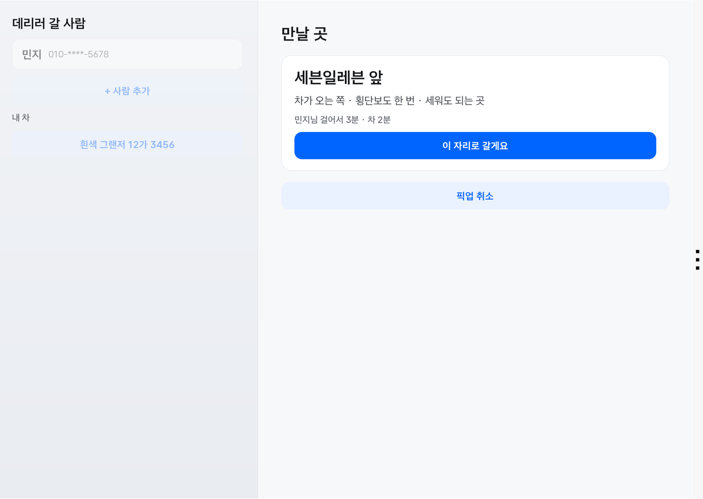

| 태울 사람 화면 | 지금 나오세요 | 차가 길 건너편으로 올 때 |
|---|---|---|
| 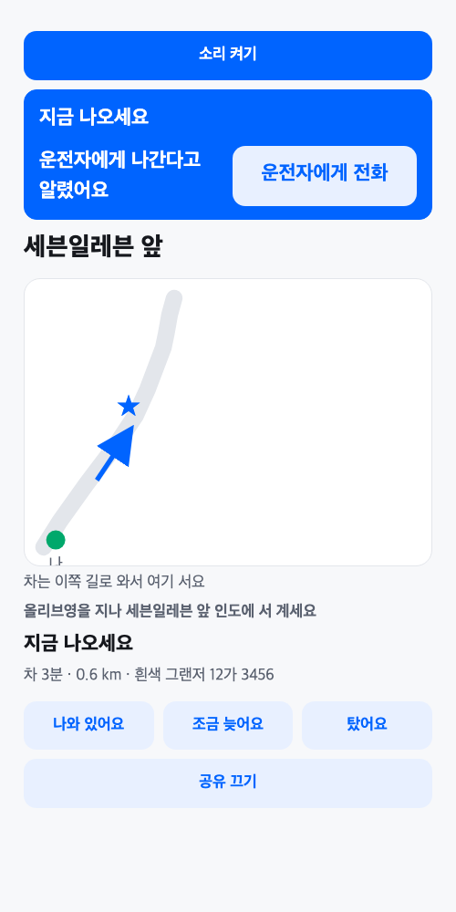 | 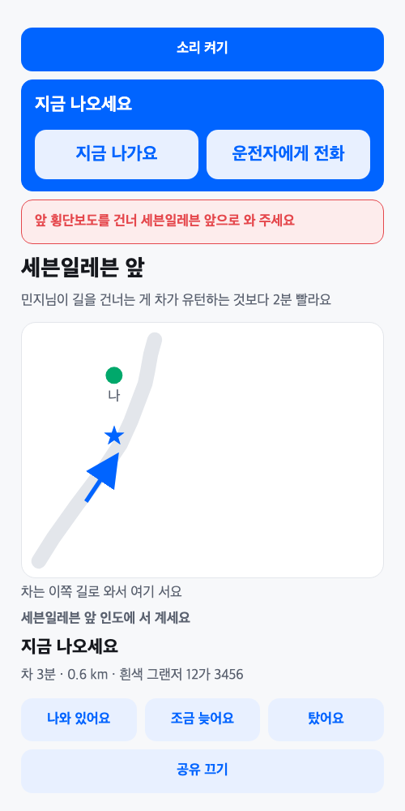 | 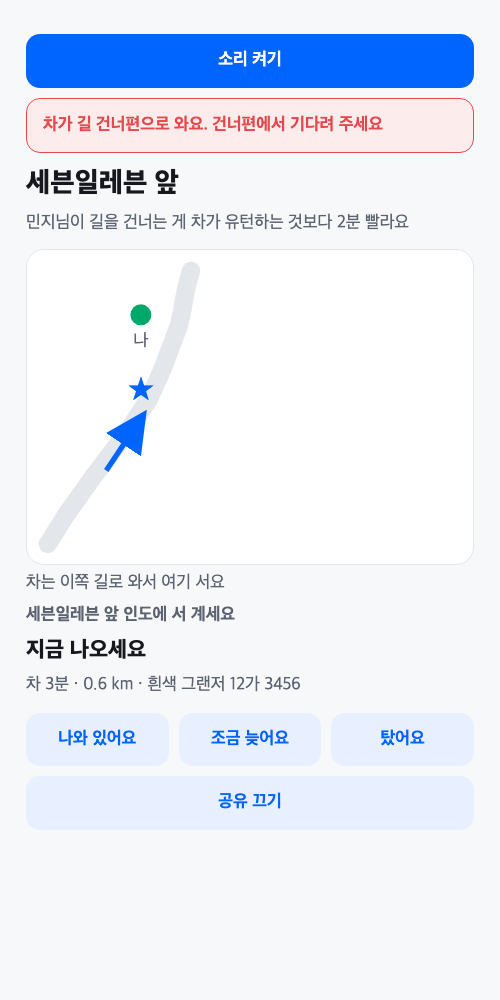 |

| 2차: 도착 확인(차, P에서) | 2차: 도착 알림(태울 사람) | 2차: 건너기·유턴 비교(차) |
|---|---|---|
| 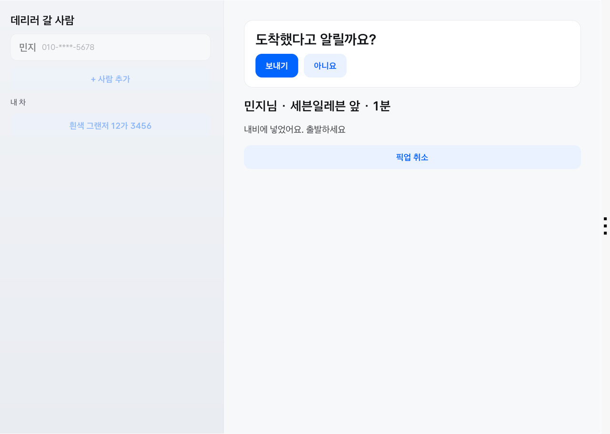 | 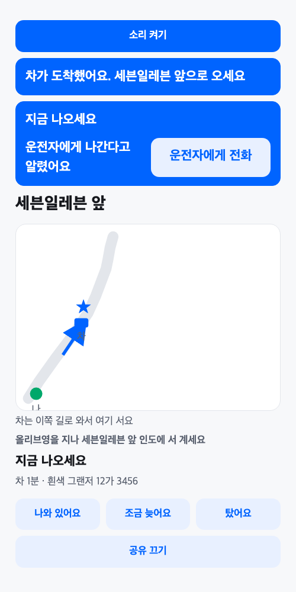 | 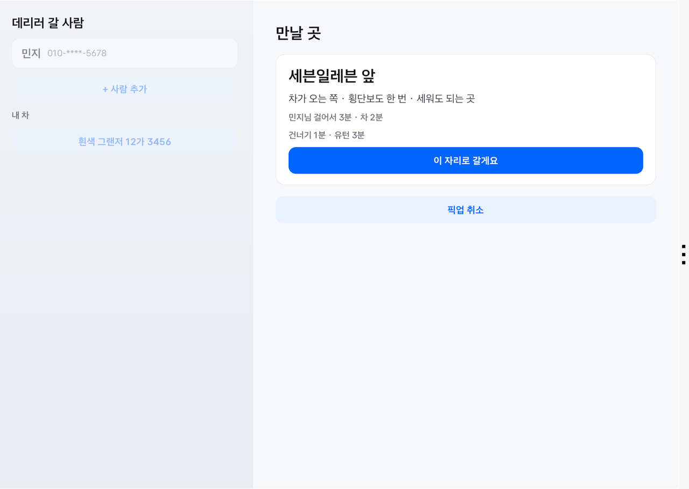 |

| 3차: 여러 명 함께, 카드 안 지도 | 3차: 연락 줄 · 알림 초읽기(P) | 3차: 연락 줄 · 통화 중(P) |
|---|---|---|
| 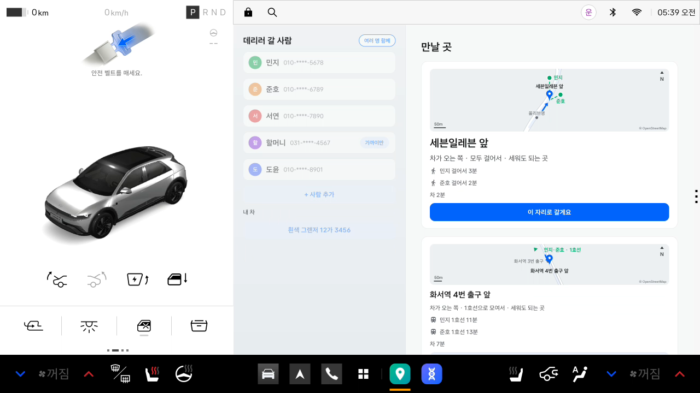 | 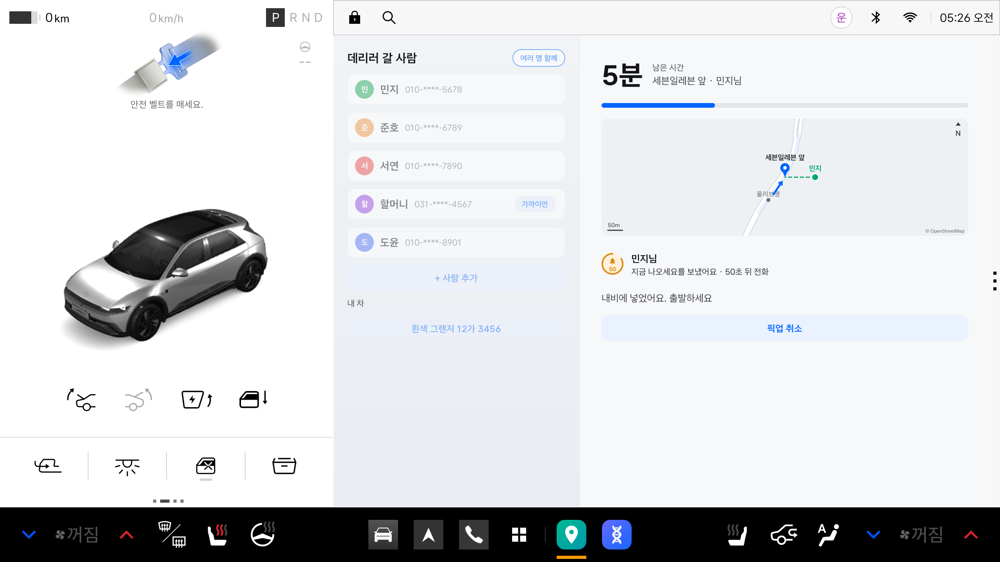 | 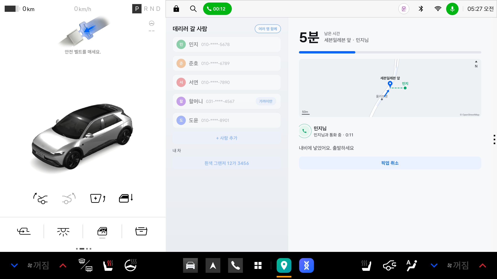 |

| 4차: 두 지도(사람과 이동 경로 · 차 세울 곳) | 4차: 대중교통 안을 보낸 직후 | 4차: 받아들인 뒤 |
|---|---|---|
| 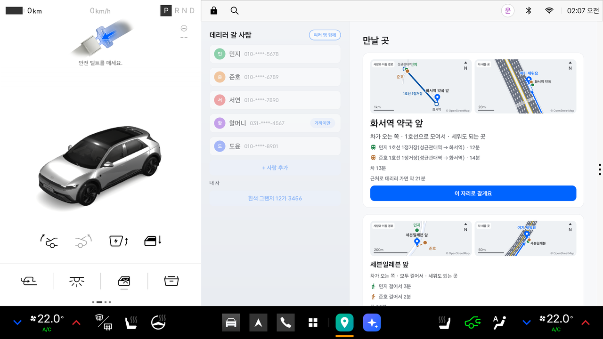 | 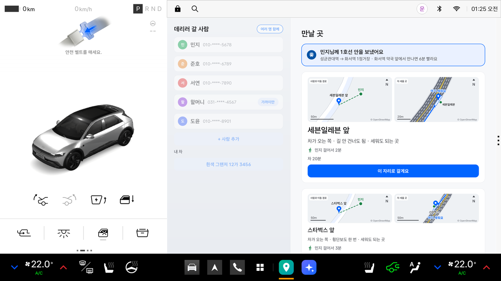 | 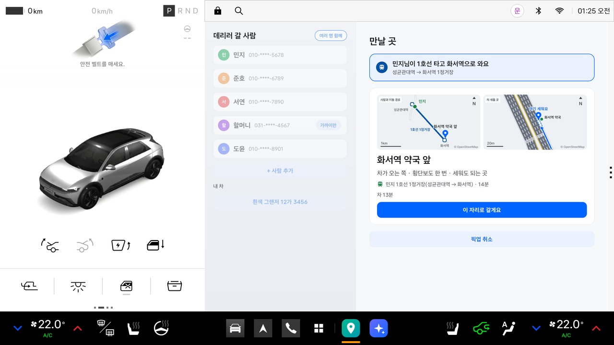 |

| 5차: 차례로 태우기 카드(만날 곳) | 5차: 첫 사람이 탄 뒤(가는 중, P) | |
|---|---|---|
| 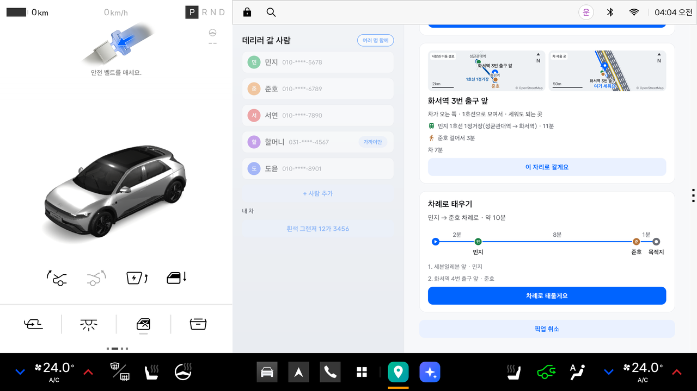 | 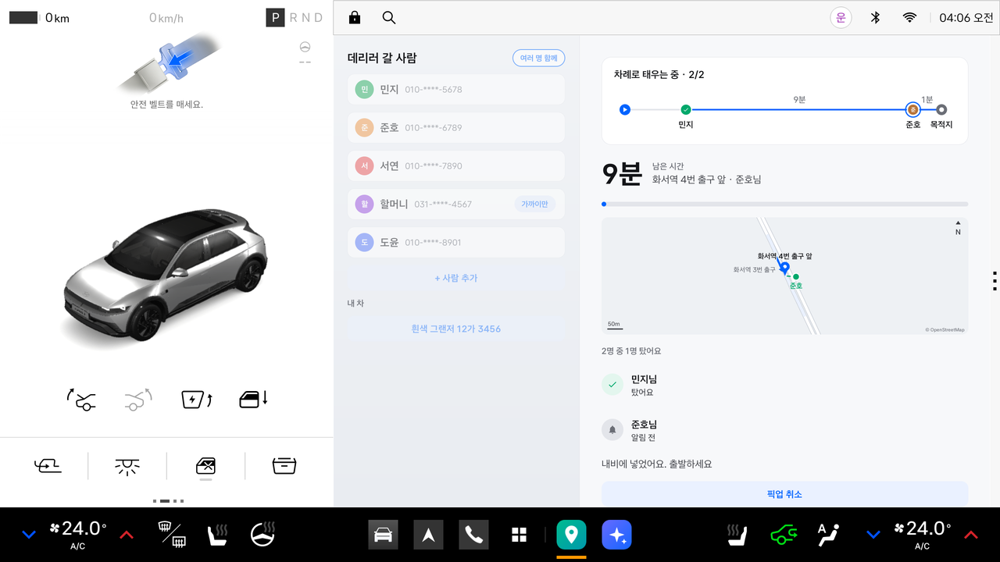 | |

## 하는 일

| | 기능 | 어떻게 |
|---|---|---|
| F1 | 같은 편 지점 | 차가 들어오는 방향의 오른쪽 길가만 고릅니다. 차가 U턴해야 하는 쪽, 편이 애매한 자리(길 선에서 3m 안), 일방통행의 왼쪽 길가, 세우면 안 되는 자리(교차로 모퉁이 5m, 버스정류장·횡단보도 10m)는 뺍니다. 1~3곳을 만나는 시각 순으로 내고, 고른 이유를 한 줄로 붙입니다("차가 오는 쪽 · 횡단보도 한 번 · 세워도 되는 곳") |
| F2 | 랜드마크 한 줄과 방향 | "세븐일레븐 앞"처럼 부르고, 태울 사람 화면에 지점 앞 길과 차가 들어오는 방향 화살표를 그립니다 |
| F3 | 서로의 위치 | 태울 사람 화면에 내 위치·지점·(300m 안이면) 차가 보입니다. 운전자는 주행 중 화면을 보지 않고 음성만 듣습니다(한 픽업에 5줄 이하) |
| F4 | 대중교통 역마중 | 버스·지하철 한두 정거장을 타고 오는 편이 **5분 넘게** 빨리 만날 때만 제안합니다. 받아들이면 지점과 내비가 정류장 근처로 바뀝니다 |
| F5 | 도착 전 알림, 그다음 전화 | 남은 시간이 "걷는 시간 + 1분"(최소 2분)에 닿으면 태울 사람 화면에 먼저 "지금 나오세요"를 보냅니다(운전자 음성 없음). 60초 안에 "지금 나가요"·"나와 있어요"를 누르거나 20m 넘게 움직이지 않았을 때만 한 번 전화합니다. 이미 나와 있으면 알리지 않고 "○○님이 나와 있어요"라고만 말합니다. 전화를 못 걸면 "○○님 폰으로 알렸어요"라고 말합니다 |
| R1 | 건너편 경고 | 남은 3분 안에 태울 사람이 지점 반대쪽 길가에 있으면 화면에 "앞 횡단보도를 건너 ○○ 앞으로 와 주세요"를 띄웁니다 |
| R2 | 150m 앞 한 줄 | 지점 길에 들어선 뒤 "오른쪽 ○○ 앞이에요". 반대 방향으로 들어오면 "○○님이 길을 건너 오른쪽으로 와요"라고 말하고 태울 사람에게 건너오라고 알립니다 |
| R4 | 탑승 확인과 공유 종료 | 지점 가까이에 서서 문이 열렸다 닫히고 비어 있던 좌석에 사람이 앉으면 "만났어요"로 끝냅니다. 끝나면 서버에서 위치가 바로 지워집니다 |
| R6 | 차 알아보기 | 태울 사람 화면에 "흰색 그랜저 12가 3456"을 보입니다 |
| 2차 | 누가 건널지 비교 | 길을 건너야 하는 지점이면 차 카드에 "건너기 1분 · 유턴 m분", 태울 사람 화면에 "○○님이 길을 건너는 게 차가 유턴하는 것보다 k분 빨라요"를 보입니다. 유턴 시간은 가장 가까운 교차로(600m 안)까지 왕복과 신호 대기 90초로 어림합니다. 표시만 하고 지점 고르기는 바꾸지 않습니다 |
| 2차 | 지나서 문구 | 지점 앞 20~150m, 같은 길가의 랜드마크를 기준으로 "오른쪽 올리브영 지나서 세븐일레븐 앞에 세우세요"라고 말하고, 태울 사람 화면에는 "올리브영을 지나 세븐일레븐 앞 인도에 서 계세요"를 보입니다(태울 사람이 기준보다 차가 오는 쪽에 있을 때) |
| 2차 | 도착 알림 확인 | 지점 50m 안에서 오른쪽 깜빡이를 켜고 3초 서면 "○○님께 도착했다고 알릴까요?"라고 묻습니다. P에서 "보내기"를 누르면 태울 사람 화면에 "차가 도착했어요. ○○ 앞으로 오세요"가 뜹니다(비상등은 SDK로 읽을 수 없어 오른쪽 깜빡이로 대신합니다) |
| 2차 | 원래 목적지로 이어 가기 | 내비에 원래 목적지(예: 집)가 있으면 지우지 않고 진입·지점을 경유지로 끼워 넣습니다. 타면 경유지만 지우고 "○○님 탑승 확인. 다음 목적지로 안내할게요". 경유지 칸이 이미 차 있으면 1차처럼 지점을 목적지로 넣고 "원래 목적지(집) 대신 만날 곳으로 안내해요"를 보입니다. 운전석 문은 탑승 판정에서 뺍니다 |

| 3차 | 여러 명 함께 태우기 | 사람 칸에서 "여러 명 함께"를 켜고 2~3명을 골라 "n명 함께 데리러 가기"를 누르면 사람마다 링크가 생깁니다. 모두가 동의·위치를 보내면(거절한 사람은 빠짐) 모두 갈 수 있는 같은 편 지점을 고릅니다. 걸어서 300m(가까이만 150m) 안이면 걷고, 아니면 타는·내리는 정류장이 모두 한도 안인 대중교통으로 모입니다. 만나는 시간은 차와 모든 사람 가운데 가장 늦은 때이고, 대중교통이 끼면 5분을 더해 견줍니다. 카드에는 사람마다 "민지 걸어서 3분", "준호 1호선 14분"과 "차 n분"이 나옵니다 |
| 3차 | 근처로 데리러 가면 | 1순위가 대중교통으로 모이는 안이면 "근처로 데리러 가면 약 n분"(사람마다 한 명 픽업 1순위를 차례로 들르는 어림, 같은 곳은 한 번)을 함께 보여 견줄 수 있게 합니다 |
| 3차 | 함께 가는 중 | 알림·전화는 사람마다 2차 규칙 그대로이고, 다른 사람에게 건 전화 뒤 60초 안에는 다음 전화를 미룹니다. 대중교통 탈 사람은 문턱 2분이고 이동을 반응으로 보지 않습니다. 모두 "알겠어요"를 누르면 "민지님, 준호님이 1호선 타고 화서역으로 와요"라고 한 번 말합니다. 가는 중에 빠진 사람은 "○○님은 이번에 함께 타지 않아요" |
| 3차 | 함께 탑승 | 새로 앉은 좌석 수와 페이지 "탔어요" 수 가운데 큰 쪽이 남은 사람 수에 닿으면 "민지님, 준호님이 탔어요"로 끝냅니다. 덜 탔으면 "2명 중 1명 탔어요" |
| 4차 | 만날 곳 두 지도 | 카드마다 지도 둘을 나란히 그립니다. 왼쪽 "사람과 이동 경로"는 함께 탈 사람·지점·탈 역과 내릴 역이 모두 들어오게 범위를 맞추고, 사람마다 첫 글자 원 색으로 걷기 점선, 노선 색으로 1호선 실선과 역을 그립니다. 오른쪽 "차 세울 곳"은 지점을 짧은 변 70m로 확대해 세울 자리 띠, 들어오는 화살표, "여기 세워요", 들어오는 방향 오른쪽 인도의 서 있을 곳을 보입니다. 지도 아래에는 사람마다 "준호 1호선 1정거장(성균관대역 → 화서역) · 14분"처럼 씁니다. 가는 중 화면의 큰 지도(차가 움직임)는 3차 그대로입니다 |
| 4차 | 대중교통 강조 카드 | 한 명 픽업에서 안을 보내면 "만날 곳" 제목 아래에 "민지님께 1호선 안을 보냈어요 / … 6분 빨라요", 받아들이면 "민지님이 1호선 타고 화서역으로 와요" 카드가 뜹니다(가는 중 화면은 맨 위). 태울 사람이 "그냥 걸어갈게요"를 고르면 카드가 사라집니다 |
| 3차 | 연락 줄 | 가는 중 사람마다 "알림 전 → 지금 나오세요를 보냈어요(줄어드는 호박색 링과 남은 초) → 통화 중 · m:ss(퍼지는 초록 물결) / 전화를 걸었어요 · n초 전 → 지금 나간대요·나와 있어요·탔어요"를 보입니다. 태울 사람 화면에는 전화하는 동안 초록 "운전자가 전화하고 있어요. 받아 주세요" 띠가 맥박치듯 커졌다 작아집니다(움직임 줄이기면 멈춤) |
| 5차 | 차례로 태우기 | 함께 태우기에서 사람마다 한 명 픽업 1순위 지점이 갈리면, 함께 모이는 곳 카드 아래에 "민지 → 준호 차례로 · 약 10분" 카드와 구간 그림(출발 —2분— 민지 —8분— 준호 —n분— 목적지)이 나옵니다. "차례로 태울게요"를 누르면 차에서 가까운 지점부터 한 곳씩 들릅니다. 한 지점 사람이 타면 "민지님이 탔어요. 다음은 준호님, 화서역 4번 출구 앞이에요"라고 말하고 내비를 다음 지점으로 바꿉니다. 태울 사람마다 자기 지점과 자기까지 남은 시간으로 알림·전화를 받습니다 |
| 3차 | 화면 디테일 | 사람 줄 첫 글자 원, 가는 중 큰 남은 분과 남은 거리 막대, 만남 화면의 "민지님, 준호님 · 확정부터 n분"(대중교통 모으기였으면 "근처로 데리러 갔다면 약 n분"), 시연 사람 다섯 명 |

조작은 정차(P) 중에만 받습니다. 목적지와 진입 경유지(지점 100m 앞)는 차의 기본 내비에 넣고, 길 안내는 내비가 합니다.

## 5차: 차례로 태우기

- **무엇이 바뀌나**
  - 만날 곳(함께 태우기): 사람마다 1순위 지점이 2곳 이상으로 갈리면 "차례로 태우기" 카드(차례, 픽업 합계 분, 구간 그림, 지점 목록, 버튼)가 함께 모이는 곳 카드 아래에 생깁니다. 함께 모이는 곳이 없어도 이 카드는 나옵니다. 이 카드가 있으면 1순위 카드의 "근처로 데리러 가면 약 n분"은 쓰지 않습니다.
  - 가는 중(P): 도착 확인 카드 아래(없으면 맨 위)에 "차례로 태우는 중 · 1/2"와 구간 그림이 있습니다. 탄 사람은 초록 체크, 지금 지점은 파란 테두리, 지난 구간은 회색입니다. 남은 시간 옆 이름과 지도는 지금 지점 사람만입니다.
  - 넘어가기: 지금 지점 사람이 모두 타면(좌석 또는 페이지 "탔어요") 한 줄로 말하고 내비를 다음 지점으로 바꿉니다. 지금 지점 사람이 빠지면 "○○님은 이번에 함께 타지 않아요. 다음은 …"과 함께 다음 지점으로 갑니다. 주행 중 음성 5줄 상한은 지점마다 셉니다.
  - 태울 사람 화면: 페이지는 그대로이고, 올라가는 값(지점, 남은 시간, "지금 나오세요")이 사람마다 자기 것입니다. 탄 사람의 "지금 나오세요" 띠는 꺼집니다.
  - 구간 시간은 어림입니다: 지점 사이는 직선 × 1.3을 시속 25km로 나누고 들르는 1분을 더합니다. 목적지 구간은 내비에 원래 목적지가 있을 때만 시속 40km로 셉니다.
- **시연**: `python3 scripts/demo.py chain`. 내비에 원래 목적지 "집"을 넣고(경유지 방식) 민지(세븐일레븐 앞) → 준호(화서역 4번 출구 앞)를 차례로 태운 뒤 집으로 이어 갑니다.
- **되돌리기**: 5차는 main(커밋 3223c1f)에 들어 있습니다. 4차로 돌아가려면 커밋 `58a6ab8`을 쓰면 됩니다.

## 실행 방법

### 1. 빌드

```bash
export JAVA_HOME=$(/usr/libexec/java_home -v 17 2>/dev/null || echo /opt/homebrew/opt/openjdk@17/libexec/openjdk.jdk/Contents/Home)
export ANDROID_HOME=$HOME/Library/Android/sdk
./gradlew :app:testDebugUnitTest :app:assembleDebug
```

**APK 위치**: `app/build/outputs/apk/debug/app-debug.apk`

### 2. 중계 서버

```bash
python3 server/server.py          # 127.0.0.1:8090. Python 3 표준 라이브러리만 쓴다
python3 server/server.py check    # 자체 점검(만들기·권한·동의·끝 상태 지우기·10분/30분 청소·사진 경로)
```

- 픽업 하나를 메모리에만 둡니다. 디스크와 로그에는 위치를 남기지 않습니다.
- 끝나면(탔어요·취소·공유 끄기·시간 지남) `status`와 `name`만 남고 10분 뒤 통째로 지워집니다.

### 3. 에뮬레이터에 설치

```bash
emulator -avd pleos -no-snapshot &      # Cold boot
adb install -r -g app/build/outputs/apk/debug/app-debug.apk
adb forward tcp:8088 tcp:8088           # Virtual Console
```

- Cold boot 뒤에는 와이파이(AndroidWifi)가 끊겨 있어 내비가 뜨지 않습니다. `demo.py reset`이 설정 화면에서 연결합니다.
- 앱은 서버를 `http://10.0.2.2:8090`(에뮬레이터에서 본 맥)으로 부릅니다.

### 4. 시연

```bash
python3 scripts/demo.py reset          # 다른 앱 정지, 와이파이 확인, P·문 닫힘, 앱 데이터(민지·내 차) 다시 쓰기, 앱 열기
python3 scripts/demo.py opposite       # 반대편 함정(약 2분): 건너편 출구의 민지를 차가 오는 쪽 편의점 앞에서 태운다
python3 scripts/demo.py transit        # 두 정거장: 1호선 한 정거장이 5분 넘게 빠를 때 제안하고 받아들인다(4차: 안 보냄 6초 → 받아들임 10초 → 가는 중 5초)
python3 scripts/demo.py handsfree      # 손 안 대는 도착(약 4분 30초): 알림, 60초 뒤 전화 한 번, 150m 한 줄, 탑승
python3 scripts/demo.py ack            # 2차: 알림을 받고 "지금 나가요" → 전화 없음
python3 scripts/demo.py arrive         # 2차: 지점에서 오른쪽 깜빡이 → 도착 확인 → 보내기
python3 scripts/demo.py continue       # 2차: 내비 목적지 "집"을 둔 채 픽업 → 타면 집으로 이어 감
python3 scripts/demo.py group          # 3차: 민지·준호를 함께 → 세븐일레븐 앞(둘 다 걸어서) → "민지님, 준호님이 탔어요"
python3 scripts/demo.py group-transit  # 3차: 남동쪽에서 출발 → 화서역 약국 앞(둘 다 1호선) → "근처로 데리러 가면 약 21분"과 비교
python3 scripts/demo.py waiting        # 3차: 알림이 나가면 길가에 세우고(P) 기다림 → 연락 줄 호박색 링 → 통화 중 초록 물결 → 나와 있어요
python3 scripts/demo.py chain          # 5차: 내비 목적지 "집"을 둔 채 민지 → 준호 차례로 태우기 → 집으로 이어 감
python3 scripts/demo.py tour           # reset → opposite → transit → handsfree
```

그 밖의 장면: `transit-small`(이득 5분 이하라 제안 없음), `reverse`(반대 방향 진입), `wrongside`(건너편 경고), `stop`(공유 끄기), `cancel`, `decline`(공유 거절), `nospot`(같은 편 자리 없음), `fallback`(전화 권한 없음 → 대체 알림), 2차 `continue-cancel`(원래 목적지를 둔 채 취소), `continue-full`(경유지 칸이 차 있음). 장면마다 하는 일과 기대 결과는 `specs/001-sameside-pickup/quickstart.md`와 `specs/002-arrive-and-continue/quickstart.md`에 있습니다. **장면은 늘 `reset` 뒤에 돌립니다.** `reset`은 내비 목적지를 "시연대기"로 맞춰 둡니다(디버그 빌드의 `DemoReceiver`).

- **태울 사람 화면**: 스크립트가 출력하는 `http://localhost:8090/p/<id>?sim=1`을 같은 맥의 브라우저로 엽니다. `?sim=1`은 브라우저 위치 대신 스크립트가 넣는 위치를 씁니다. 처음에 "소리 켜기"를 한 번 누르면 "지금 나오세요" 소리가 납니다.
- 브라우저로 `127.0.0.1:8088` 콘솔 페이지를 열어 둔 채 스크립트를 돌리면 페이지에 남은 상태가 다시 들어갑니다. 스크립트로 시연할 때는 콘솔 페이지를 닫으세요.
- 주행 중에는 내비가 앞에 있고 앱은 음성만 냅니다. 스크립트는 P로 돌린 뒤 앱을 앞으로 가져와 결과를 확인합니다.

## 테스트 환경과 설정

- Pleos Connect Emulator v2.1.0(Android API 34), 가로 2560×1440
- Pleos Vehicle SDK 2.3.2, NaviHelper 3.0.5, FusedLocation 1.1.3, TextToSpeech 3.3.1(온디바이스), ZXing core 3.5.3(QR)
- 권한: `pleos.car.permission.CAR_DRIVE`·`CAR_DOORS`·`CAR_SEATS`·`FUSED_LOCATION`·`NAVI_ROUTE`·`NAVI_ROUTE_SEARCH`, TTS, `CALL_PHONE`, 인터넷, 알림, 포그라운드 서비스(`specialUse`)
- JDK 17, Gradle 8.11.1, AGP 8.8.2, Kotlin 2.0.21. 서버와 시연 스크립트는 Python 3(표준 라이브러리만)
- 단위 테스트: `app/src/test/java/kr/skku/sameside/PickTest.kt`(지점 고르기, 남은 시간, 자동 전화, 150m, 건너편, 대중교통, 탑승·끝). 장면 좌표 `scripts/scenes.txt`를 시연 스크립트와 함께 읽어, `handsfree` 경로를 1초씩 재생해 자동 전화 시각도 확인합니다.

## 시연용 준비 데이터와 출처

- 시연 지역은 성균관대역(수원 서부로) 주변과 화서역 주변 두 묶음입니다. 길·정류장·횡단보도·랜드마크 좌표는 OpenStreetMap에서 받아 `app/src/main/java/kr/skku/sameside/Area.kt`에 넣었습니다. **© OpenStreetMap contributors**, [ODbL](https://opendatacommons.org/licenses/odbl/) 라이선스입니다.
- 대중교통(1호선 성균관대역 → 화서역 한 정거장, 대기 4분·승차 3분)은 시연용 준비값이고 실시간이 아닙니다. 태울 사람 화면에도 "시연용 준비 데이터예요"라고 적습니다.
- 장면 좌표(차 출발점, 경로, 태울 사람 위치)는 `scripts/scenes.txt`입니다.

## 문서

- 설계 초안: `docs/superpowers/specs/2026-11-09-pickup-app-design.md`, 2차 `docs/superpowers/specs/2026-11-10-pickup-additions-design.md`
- 2차 명세·검증: `specs/002-arrive-and-continue/`(알리고 나서 전화, 도착 알림, 원래 목적지로 이어 가기, 건너기·유턴 비교, 지나서 문구)
- 3차 설계: `docs/superpowers/specs/2026-11-11-pickup-group-design.md`, 명세·검증: `specs/003-group-pickup/`(여러 명 함께, 카드 안 지도, 연락 줄, 화면 디테일)
- 4차 설계: `docs/superpowers/specs/2026-11-11-pickup-feedback-design.md`, 명세·검증: `specs/004-maps-transit-video/`(만날 곳 두 지도, 대중교통 강조 카드, 시연 영상 자막·전화 강조)
- 5차 설계: `docs/superpowers/specs/2026-11-12-pickup-chain-design.md`, 명세·검증: `specs/005-chain-pickup/`(차례로 태우기와 구간 그림)
- 명세·계획·작업·검증: `specs/001-sameside-pickup/`
  - `spec.md`, `plan.md`, `research.md`(에뮬레이터 측정), `data-model.md`(판단 규칙), `contracts/`(서버 API, 화면 문구), `quickstart.md`(장면), `tasks.md`
  - `goldfish-review.md`(설계 문서 리뷰), `verification.md`(에뮬레이터 결과)
- 화면 캡처: `docs/screenshots/`

## 한계

- **남은 시간은 직선거리 추정입니다.** 차 위치에서 진입 경유지까지 직선거리 × 1.3 + 100m를 최근 30초 평균 속도(최저 시속 20km)로 나눕니다. 길이 많이 굽은 곳에서는 자동 전화가 이르거나 늦을 수 있습니다. 실차에서는 내비의 남은 시간(`DrivingInfo.duration`)으로 바꿀 수 있지만, 에뮬레이터 내비는 자기 위치가 판교에 고정돼 있어 쓰지 않았습니다.
- **U턴 판정도 직선 방위입니다.** 차에서 지점으로 가는 방향과 지점 길가의 진행 방향이 100° 넘게 어긋나면 뺍니다. 블록을 크게 도는 경로는 알지 못합니다.
- **한 지역 준비 데이터만 있습니다.** 다른 지역은 같은 형식(`Area`)으로 데이터를 넣어야 합니다. 랜드마크 사진은 아직 없어 화면에서 숨깁니다.
- **링크는 같은 맥에서만 열립니다.** 1차 서버는 `127.0.0.1`의 HTTP입니다. 실제 폰으로 보내려면 HTTPS 서버와 문자·메신저 보내기가 필요합니다.
- **전화는 에뮬레이터의 모의 통화로만 확인했습니다.** 실차는 블루투스로 연결된 폰으로 걸어야 하고, 차에서 전화가 막혀 있을 수 있습니다. 그래서 전화와 함께 태울 사람 화면 알림을 항상 보냅니다.
- **에뮬레이터 착좌 신호는 콘솔 값의 반대로 옵니다**(research R5). 앱은 SDK 값을 그대로 믿고, 시연 스크립트가 에뮬레이터에 맞춰 씁니다. 실차에서 어느 쪽이 맞는지는 확인하지 못했습니다.
- 처음 보는 사람 3명의 30초 이해 테스트(SC-005)는 아직 하지 않았습니다.
- **2차 내비 경유지 동작은 에뮬레이터의 내비 상태 값으로만 확인했습니다.** 에뮬레이터 내비는 자기 위치가 판교에 고정돼 "경유지를 지나 원래 목적지로 이어 간다"는 화면 이동을 볼 수 없습니다. 안내 중 `cancelRoute`를 무시하는 에뮬레이터 동작 때문에, 앱이 마지막으로 넣은 목적지 이름(`navOwn`)과 같은 목적지는 원래 목적지로 보지 않습니다.
- **오른쪽 깜빡이를 켜면 에뮬레이터가 측방 카메라 창을 띄워 화면 왼쪽을 가립니다.** 도착 확인 카드의 버튼이 가려질 수 있어, 시연은 P에 놓고 깜빡이를 끈 뒤 "보내기"를 누릅니다. 실차의 카메라 창 위치는 확인하지 못했습니다.
- **알림 뒤 20m 넘는 이동을 반응으로 봅니다.** 실내처럼 위치 오차가 크면 움직이지 않아도 반응으로 보고 전화를 걸지 않을 수 있습니다(잠정값, 실측 필요). 내비가 경로를 다시 잡는 몇 초 동안은 목적지가 빈 값으로 읽혀, 그때 지점을 확인하면 원래 목적지 대신 지점을 목적지로 넣습니다.
- **함께 태우기 탑승은 에뮬레이터에서 페이지 "탔어요"로 확인했습니다.** 에뮬레이터는 뒷좌석 착좌를 늘 앉음으로 보내 둘째 좌석을 셀 수 없습니다. 실차에서는 새로 앉은 뒷좌석도 셉니다.
- **주행(D) 중에는 연락 줄이 가려집니다.** Pleos가 비DO 앱을 가리기 때문입니다. 전화를 걸 때 앱 알림("○○님께 전화 중")도 띄워 봤지만 주행 중 화면에 보이지 않아 뺐습니다. 대신 음성 "○○님께 전화 걸게요"와 Pleos 상태 표시줄의 초록 통화 칩이 있고, 태울 사람 화면에는 전화 띠가 뜹니다.
- **"근처로 데리러 가면"은 직선 어림입니다.** 사람마다 한 명 픽업 1순위를 차에서 가까운 차례로 들른다고 보고 직선 × 1.3, 시속 25km, 들를 때마다 1분으로 셉니다.
- **카드 지도는 지역 데이터의 길 선만 그립니다.** 건물·지형은 없고, 길 폭은 10m로 그립니다.
- **차례로 태우기의 순서와 구간 시간은 직선 어림입니다.** 차에서 가까운 지점부터 고르고(욕심 방식), 둘째 지점 이후의 들어오는 방향은 계획할 때 차 위치 기준입니다. 함께 모이는 곳 없이 차례 계획만 있을 때는 확정 전 태울 사람 화면에 만날 곳 안내가 없습니다(확정하면 자기 지점이 보입니다).
- **넣지 않은 것**: 로드뷰(네이버 지도 API 키가 필요), 음성 입력("5분 늦는다고 전해줘", 에뮬레이터에서 말소리를 넣어 시험할 수 없음), 비상등(SDK에 값이 없음).
- 상시 포그라운드 서비스(`specialUse`)가 Pleos App Market 심사에서 허용되는지 확인하지 못했습니다.
